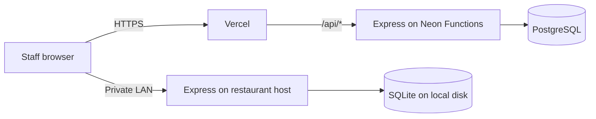

# Architecture

Leslie's has one React frontend and one Express API. Cashiers, kitchen staff, and administrators share the same database. React selects the workspace after sign-in. Express checks the employee's role for each protected operation.

## Request path

In the cloud, Vercel serves the Vite build and forwards API traffic to the Neon Function through a same-origin rewrite. On a private network, Express serves both the build and the API. During local development, Vite forwards API requests to Express on port 3000. The kitchen queue and cashier status feed poll the API every five seconds.

## From checkout to reporting

1. **Checkout.** A cashier submits menu item IDs, quantities, notes, payment details, and an optional dine-in table. The API reads current prices and calculates the total and cash change in integer centavos.
2. **Order storage.** A single transaction writes the order and its lines and marks a dine-in table occupied. Each line stores the dish name and unit price at checkout, so an edit to tomorrow's menu preserves today's receipt.
3. **Kitchen.** Tickets move from **Pending → Preparing → Ready → Completed**. A status update must match the current stored state. Completion releases the table in the same transaction when it has no other active order.
4. **Reporting.** Completed orders contribute to sales totals, payment breakdowns, and best-seller reports. The PostgreSQL queries group sales by the Asia/Manila business date. SQLite reports use the host's local date.

## Data model

| Records | Relationship and purpose |
| --- | --- |
| `users`, `auth_sessions` | Each employee has a role and bcrypt password hash. Signing in creates a 12-hour bearer token. The database stores its SHA-256 hash and expiration. |
| `categories`, `menu_items`, `menu_images` | A category groups dishes. A menu item has a price, availability, and an optional photo. The menu response carries the photo version so the browser can fetch the image separately. |
| `restaurant_tables`, `orders`, `order_items` | Each order belongs to a cashier and contains one or more lines. Dine-in orders reference a table. Takeout orders have no table assignment. |
| `inventory_items`, `stock_movements` | An administrator records additions and deductions. Each movement keeps the employee, amount, timestamp, and optional notes. The balance and movement commit together. |

The photo endpoint serves a versioned WebP. Sharp accepts input up to 2 MiB and 25 megapixels and fits the output within 960 × 960 pixels. Replacing a photo gives it a new URL. Anyone with that URL can view the menu image.

## Implementation map

| Code | Responsibility |
| --- | --- |
| [React workspaces](client/src/pages) and [API client](client/src/services/api.js) | Role-specific screens, forms, receipts, and authenticated HTTP requests |
| [Express app](server/src/app.js) and [routes](server/src/routes) | API routing, authorization, validation, and restaurant workflows |
| [Neon entry point](server/src/function.js) and [LAN entry point](server/src/server.js) | Adapt the same Express app to a Neon request handler or a local HTTP listener |
| [Database adapters](server/src/database/queries.js) | Select PostgreSQL when `DATABASE_URL` is configured, or SQLite for local installations |
| [PostgreSQL schema](server/src/database/postgres.sql) and [SQLite schema](server/src/database/schema.sql) | Tables, relationships, constraints, and indexes |

PostgreSQL uses a pooled connection for ordinary API traffic and a dedicated client for the duration of each transaction. SQLite serializes access to its shared connection while a transaction runs. Integration checks submit competing orders for one table and competing deductions against one stock balance. See the [deployment guide](docs/production-deployment.md) for the commands to run them.
