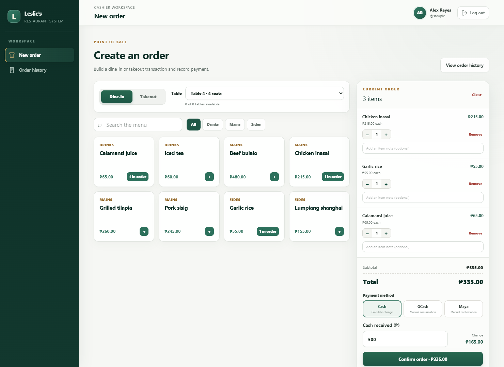

# Leslie's Restaurant Management System

A cashier takes an order, the kitchen prepares it, and the manager sees the completed sale. Leslie's is a full-stack restaurant application that connects those three desks through a shared order record. It supports dine-in and takeout service, Philippine peso pricing, and printable receipts.



*Cashier workspace with sample menu items. Selecting a table, entering item notes, and recording payment all happen on this screen.*

## What each employee can do

| Workspace | Daily tasks |
| --- | --- |
| Cashier | Browse the menu by category, add item notes, record cash or a manually confirmed GCash or Maya payment, print a receipt, and follow the order's kitchen status. |
| Kitchen | Read incoming tickets and preparation notes, mark orders ready, and complete them to release their tables. |
| Administrator | Manage staff, dishes, menu photos, tables, and stock. Review completed sales by date, payment method, or best-selling item. |

## Engineering highlights

- **One order per occupied table.** The Express API checks the table, reads current menu prices, and saves the order, line items, and table assignment in one database transaction. Each line keeps its price at the time of sale.
- **Inventory with a history.** Each stock adjustment records the employee, quantity, and optional notes in the same transaction as the balance change. Concurrent deductions cannot drive stock below zero.
- **Menu photos that travel with the data.** The API validates JPEG, PNG, and WebP uploads, resizes them with Sharp, and saves a WebP copy alongside the menu record. Database backups include the photos.

## Run locally

Use Node.js 24 and npm. From a fresh checkout, the following commands start a local SQLite installation:

```sh
git clone https://github.com/estoceorlan-dev/Leslie-s-Restaurant-Management-System.git
cd Leslie-s-Restaurant-Management-System
npm ci
npm run db:init
npm run admin:create
npm run dev
```

Open [the local app](http://localhost:5173) and sign in with the administrator account you just created. To try a complete order, add a menu category and dish, create cashier and kitchen accounts under **Employees**, then place a takeout order as the cashier. Complete it in the kitchen queue and open **Reports** as the administrator.

Run `npm run check` to build the frontend and exercise authentication, photo uploads, ordering, kitchen transitions, concurrent stock deductions, reporting, and SQLite backup and restore.

## Architecture and deployment

The React and Vite frontend calls a Node.js and Express API. The cloud configuration uses Vercel, Neon Functions, and PostgreSQL. For a restaurant LAN, one host can serve the frontend and API with SQLite on local disk.

- [Architecture](Architecture.md) covers the request path, data model, and transaction boundaries.
- [Deployment guide](docs/production-deployment.md) covers Vercel and Neon dashboard setup, migration from SQLite, and private-network installation.
